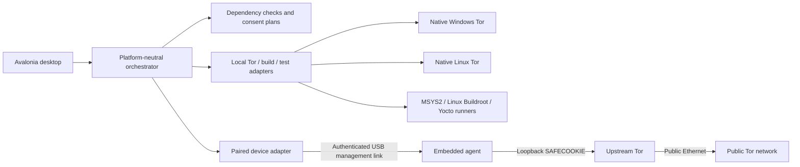

# 01 — System architecture and contracts

Status: ASSUMPTION — proposed architecture, no implementation in Phase 0.
Grounding: [audit](00-repository-audit.md), `scripts/validate.py`,
`scripts/common.py`, `tests/run_all.py`, `windows-native/build-windows.sh`,
`br2-external/board/qemu-production/overlay/etc/tor/torrc`.

## Boundaries and traffic



PC A ↔ USB ↔ endpoint A ↔ public Tor ↔ endpoint B ↔ USB ↔ PC B is the
embedded product path. Private Tor identities remain on each endpoint.
Desktop local-Tor mode instead keeps its own identity in a private local user
directory; modes never copy identities between PC and board. A GUI on Linux
does not itself imply a local Linux Tor workload; the native Linux runtime is
an approved capability whose exact v1 UI exposure remains an open decision.

| Component | Responsibility / prohibited coupling |
| --- | --- |
| Avalonia UI | Dashboard, dependency wizard, build/artifact manager, Tor/config controls, devices, tests, benchmarks, logs/reports. Displays capability/uncertainty and queued work; never runs shell text or reads Tor keys. |
| Core orchestrator | Typed commands, DAG scheduling, capability checks, consent receipts, cancellation/retry, evidence association. No Win32, WSL paths, views or compiler flags in core contracts. |
| Platform adapters | Translate validated plans to argument arrays and process trees. Separate Windows UCRT64, Linux-native, WSL/Linux Buildroot, Yocto and device adapters; map exit codes without hiding originals. |
| Dependency resolver | Read-only detection → version/hash/capability decision → reviewable install plan. Install execution is a separate explicit operation. Does not launch auto-installing `compile.sh` during detection. |
| Tor control driver | Parse PROTOCOLINFO, authenticate SAFECOOKIE, handle multiline replies and asynchronous events, subscribe bootstrap/HS_DESC, stop/restart safely. Reuse upstream Tor; no new circuit, crypto, TLS or routing implementation. |
| Task/build graph | Deterministic inputs, dependency edges, exclusive mutable outputs, resource reservations, resumable verified downloads. A build PASS does not imply test or policy acceptance. |
| Device agent | Least-privilege status and allowlisted Tor lifecycle/config/data-bridge RPC. Separate narrow privileged helper only for approved deployment. No arbitrary shell, raw key export or Internet management listener. |
| Delivery/evidence | Verify hashes/signatures according to recorded trust policy, pair artifact and exact board, stage inactive slot, verify, boot-test/rollback; export sanitized reports with digests. Never flash on discovery or on build completion. |

Use a paired TLS channel with mutual authentication as the proposed USB
management boundary (ASSUMPTION; protocol/library/agent language not selected).
Pair on a physically local UART/USB workflow with fingerprint confirmation;
store per-device credentials in OS-protected storage and endpoint mode-0700
state; support revoke/re-pair. USB proximity alone grants no trust. No default
password, credentials in argv, control cookie over USB, or external ControlPort.
The [Tor control specification](https://torproject.gitlab.io/torspec/control-spec/)
is the protocol authority; existing `tests/run_all.py` and
`scripts/capacity_native.py` already exercise SAFECOOKIE behavior.

ASSUMPTION: the device adapter supplies a PC-loopback SOCKS tunnel terminating
at endpoint-loopback SOCKS. An endpoint loopback application bridge forwards
Onion Service traffic to the paired PC application over an authenticated data
channel. Preserve both directions, stream backpressure, EOF/half-close and
bounded buffers; no arbitrary destination proxying. Tunnel/RPC multiplexing
and resource limits require a dedicated prototype and security review before
activation. A disconnected PC stops its bridge; Tor identity survives and no
traffic is rerouted through the public Ethernet management plane. A separately
authenticated direct USB-only SOCKS binding is an alternative requiring an
explicit reviewed policy, not a default fallback.

USB must have no default route/DNS override on the PC or board. Tor egress uses
Ethernet; forwarding/bridging between USB and Ethernet is disabled. Firewall
both IPv4 and IPv6; no wildcard agent/control/SOCKS listeners. See hardware
conditions in [03](03-hardware-yocto-plan.md). UART is bring-up/recovery;
an authenticated Ethernet maintenance session is a manually enabled diagnostic
fallback, isolated from the normal public-facing Ethernet path.

## Proposed repository layout (nothing moved or created here)

| Future path | Owner / purpose |
| --- | --- |
| `desktop/Tor.Desktop/` | Avalonia views/viewmodels; Windows x64 and Linux x64 run-only publishes |
| `desktop/Tor.Contracts/`, `desktop/Tor.Core/` | Contract bindings, state machine, scheduling, evidence/consent orchestration |
| `desktop/Tor.Adapters/{Windows,Linux,Wsl,Device}/` | Process/path/transport implementations; no UI references |
| `desktop/Tor.Control/` | Local authenticated Tor Control Protocol driver |
| `config/contracts/`, `config/dependencies/` | Versioned JSON schemas, dependency locks/compatibility and remediation metadata |
| `scripts/dependencies/`, `scripts/native_linux/` | Stdlib read-only CLI/resolvers and native Linux build adapter; retain existing scripts in place |
| `device/tor-agent/` | Small native embedded management service, language BLOCKED on dependency/resource review; no .NET GUI/runtime planned on the board |
| `yocto/meta-tor-minimal/` | Own layer, exactly baseline/minimal images; vendor BSP checkout stays ignored outside tracked layer |
| `config/firmware/`, `scripts/firmware/` | Board/layout/update policy and explicit delivery adapters |
| `tests/`, `desktop/tests/`, `device/tests/` | Existing frozen tests preserved; new contract/behavior/security tests beside their component |
| `reports/` | Sanitized manifests/results; retain existing history, sealed references and failures |

Keep `br2-external/`, `config/profiles/`, `config/sources.lock.json` and
`windows-native/` in place. No product .NET project/package is selected by this
document. [Avalonia platform requirements](https://docs.avaloniaui.net/docs/supported-platforms)
and [.NET publishing](https://learn.microsoft.com/en-us/dotnet/core/deploying/)
support separate self-contained desktop distributions; native OS dependencies
still need detection ([matrix](02-dependency-matrix.md)).

## Reviewed v1 target and ownership

Review accepted for TASK 01: TechNexion PICO-IMX6UL is the primary physical v1
target; DHCOM is historical only. Exact PICO SKU/carrier/DTB remain BLOCKED.
Native Linux v1 selects `x86_64-linux-gnu`, glibc **2.39** on Ubuntu 24.04 LTS
as its reference ABI (Ubuntu package revision may vary and is recorded). Other
ABIs require separate future target descriptors/policies, not implicit fallback.
[Ubuntu libc6 package](https://packages.ubuntu.com/noble/libc6) documents this
reference; no native Linux runtime/build qualification is claimed.

W1 exclusively owns shared schemas/validator. W2 integrates W1; W3 integrates
W2 after W1. Independent preparation/tests may run in parallel. Discovery and
preflight never install, download or invoke COMPILE.cmd. Yocto build RAM
reservations apply only to future Yocto builds and cannot block W1–W3.

## Typed contract baseline

The following TypeScript-style interfaces are a specification example only;
they require no TypeScript runtime. ASSUMPTION: future JSON Schema 2020-12
documents under `config/contracts/` will encode these constraints and generate
or validate C# bindings. All eight contracts carry `schemaVersion: 1`;
incompatible versions fail closed. `Ref` values are opaque scoped IDs or
sanitized report-relative paths, not arbitrary paths/URLs from a device.

```typescript
type Ref = string;
type Sha256 = string; // exactly 64 lowercase hex digits; never a placeholder in real evidence
type Certainty = "verified" | "UNVERIFIED" | "ASSUMPTION" | "BLOCKED";
type ResultStatus = "PASS" | "FAIL" | "SKIPPED" | "BLOCKED" | "NOT RUN";
type Scope = "unit" | "host-native" | "simulation" | "physical";
type Metric = {
  value: number | null; unit: "B" | "s" | "B/s" | "%" | "count";
  method: string | null; unavailableReason: string | null;
};
interface TargetDescriptor {
  schemaVersion: 1; id: string;
  kind: "windows-native" | "linux-native" | "buildroot-qemu" | "pico-yocto";
  os: "windows" | "linux"; architecture: "x86_64" | "armv7";
  abi: "ucrt64" | "glibc" | "musl" | null; abiVersion: string | null;
  executionScope: Scope; boardPart: string | null; carrierRevision: string | null;
  machine: string | null; dtbSha256: Sha256 | null;
  capabilities: string[]; certainty: Certainty; evidenceRefs: Ref[];
}
interface DependencyCheck {
  schemaVersion: 1; id: string; targetId: string;
  status: "AVAILABLE" | "MISSING" | "INCOMPATIBLE" | "UNKNOWN" | "BLOCKED";
  requirement: string; detectedVersion: string | null; architecture: string | null;
  requiredFor: ("run-only" | "developer" | "embedded")[]; optional: boolean;
  owner: "bundled" | "app-local" | "package-manager" | "os-manual" | "hardware";
  approval: "none" | "user-consent" | "privileged-manual";
  expectedSha256: Sha256 | null; observedSha256: Sha256 | null;
  reason: string; remediationPlanRef: Ref | null; evidenceRefs: Ref[];
  certainty: Certainty;
}
interface BuildRequest {
  schemaVersion: 1; requestId: string; targetId: string;
  imageProfile: "baseline" | "minimal" | null; // only Yocto uses this field
  existingProfileId: string | null; // existing Buildroot IDs remain unchanged
  sourceCommit: string; dirtyInputManifestRef: Ref | null;
  sourceLockSha256: Sha256; configSha256: Sha256; toolchainManifestSha256: Sha256;
  inputSha256: Sha256; adapterId: string; outputScopeRef: Ref;
  mode: "plan" | "build"; maxJobs: number; ramBudgetBytes: number;
  diskBudgetBytes: number; cancellationId: string;
  consentReceiptRefs: Ref[]; // scoped installs/downloads only; never authorizes flashing
}
interface TaskProgress {
  schemaVersion: 1; taskId: string; parentTaskId: string | null; sequence: number;
  timestampUtc: string; phase: string;
  state: "queued" | "running" | "cancelling" | "cancelled" |
         "succeeded" | "failed" | "blocked" | "interrupted";
  completed: number | null; total: number | null;
  unit: "B" | "steps" | "%" | null; message: string;
  cancellationSupported: boolean; retryOfTaskId: string | null;
  rawExitCode: number | null; terminationSignal: number | null;
  reasonCode: string | null; logRef: Ref | null;
}
interface BuildArtifact {
  schemaVersion: 1; id: string; taskId: string; targetId: string;
  kind: "runtime-package" | "kernel" | "dtb" | "rootfs" | "disk-image" |
        "bootloader" | "update-bundle";
  imageProfile: "baseline" | "minimal" | null; pathRef: Ref;
  bytes: number; sha256: Sha256; inputSha256: Sha256;
  sourceManifestRef: Ref; licenseManifestRef: Ref; toolchainManifestRef: Ref;
  signature: {status: "verified" | "failed" | "not-verified";
              verifierKeyId: string | null; evidenceRef: Ref | null};
  compatibleTargetIds: string[]; layoutId: string | null;
  containsPrivateState: false; qualificationEvidenceRefs: Ref[];
}
interface DeviceInfo {
  schemaVersion: 1; deviceId: string; targetId: string | null;
  pairing: "unpaired" | "paired" | "revoked"; peerFingerprint: string | null;
  boardPart: string | null; carrierRevision: string | null;
  agentVersion: string | null; firmwareArtifactId: string | null;
  kernelVersion: string | null; dtbSha256: Sha256 | null; bootSlot: string | null;
  ramBytes: number | null; storageBytes: number | null; stateFreeBytes: number | null;
  usbRole: "device" | "host" | "unknown"; ethernetUp: boolean | null;
  clockSynchronized: boolean | null; entropyReady: boolean | null;
  torBootstrapPercent: number | null; capabilities: string[];
  observedAtUtc: string; certainty: Certainty; evidenceRefs: Ref[];
}
interface TestResult {
  schemaVersion: 1; runId: string; testId: string; taskId: string;
  targetId: string; scope: Scope; mode: "offline" | "online";
  status: ResultStatus; reason: string; protocolId: string; policySha256: Sha256;
  startedAtUtc: string | null; durationSeconds: number | null;
  rawExitCode: number | null; logRefs: Ref[]; artifactIds: string[];
  metrics: Record<string, Metric>; environmentRef: Ref;
}
interface EvidenceManifest {
  schemaVersion: 1; id: string; timestampUtc: string;
  source: {commit: string; dirty: boolean; inputManifestRef: Ref;
           inputSha256: Sha256; sourceLockSha256: Sha256};
  target: TargetDescriptor; environmentRef: Ref; toolchainManifestRef: Ref | null;
  policySha256: Sha256; protocolId: string; workloadRef: Ref;
  artifacts: BuildArtifact[]; tests: TestResult[];
  metrics: Record<string, Metric>; logs: {ref: Ref; sha256: Sha256}[];
  comparison: {referenceId: string | null;
    status: "NOT RUN" | "INCOMPLETE" | "NON_COMPARABLE" | "REJECTED" | "ACCEPTED";
    reasons: string[]};
  limitations: string[]; redactionPolicyId: string;
}
```

### Contract invariants and lifecycle

| Contract(s) | Required validation and behavior |
| --- | --- |
| TargetDescriptor / DeviceInfo | Board/DTB/ABI cannot be inferred from architecture alone. Unknown capacity is null. Claims of physical verification require serial/device evidence. A firmware match requires exact part, carrier, layout and DTB, not just `armv7`. No private serial/key material in shareable exports. |
| DependencyCheck | `AVAILABLE` requires an executed compatible probe. `MISSING` means absent; `INCOMPATIBLE` means observed but wrong version/architecture; `UNKNOWN` means insufficient or unparseable evidence; `BLOCKED` means probe denied, timed out or otherwise could not execute. None of the latter four is PASS. Install ownership, optionality and approval are separate axes. Hash mismatch blocks execution; package-manager signatures and source signatures have distinct evidence. |
| BuildRequest / BuildArtifact | Positive integer jobs/budgets; finite nonnegative artifact bytes. Validate profile applicability, lock/toolchain hashes and output containment before launch. No free-form shell/config injection. No reuse across different input/toolchain/ABI hashes. Build artifacts contain no private identity/state. A hash is mandatory for a produced artifact; null means no artifact object is emitted. |
| TaskProgress | Sequence strictly increases per task. Numeric progress only when denominator is reliable, `0 <= completed <= total`, total positive; otherwise both null. Download bytes may be exact; compiler output lines are not a percentage. Tor bootstrap is phase-specific 0–100, not overall build completion. UI remains responsive during logs/events. |
| Cancellation | Persist queued/running state before starting. Request cancellation by ID; stop new DAG children, signal process tree, allow bounded graceful shutdown then terminate through platform adapter. Preserve partial outputs/logs, mark cancelled; never publish an artifact as complete. Uninterruptible flash commit reports cancellation unsupported, with a defined recovery boundary. |
| Retry / queue recovery | Retry creates a new task/run linked to the original, revalidates inputs, state ownership and cache hashes. After an app or runner crash, unreconciled running/cancelling work becomes explicit `interrupted`, with reasonCode `app-crash`, `runner-crash` or `runner-lost`, rawExitCode/terminationSignal null unless observed. This is neither cancelled nor succeeded; retry creates a new task ID after reconciliation. Never repeat installation, deployment or identity creation silently. Only independently read-only probes auto-retry. |
| Exit codes | Keep native Windows unsigned process exit and POSIX exit/signal separately. Internal reason codes describe cancelled, prerequisite missing, permission denied or process failure. Existing `validate.py` exit 1 can mean REJECTED/NON_COMPARABLE/INCOMPLETE, not just compiler failure; read its JSON and original status. No invented legacy code mapping. |
| TestResult / EvidenceManifest | Status, scope and comparison are independent. New wrapper accepts NOT RUN; existing `scripts/common.py` schema accepts only PASS/FAIL/SKIPPED/BLOCKED, so never inject new statuses into legacy JSON. Preserve raw legacy file/digest and normalize in a separate envelope. All nine required PASS plus complete metrics and comparability are necessary for existing acceptance. |
| Measurements | Null needs an unavailable reason; non-null needs units and collection method, finite values, explicit workload/environment. Windows working set is not Linux PSS/RSS equivalence. Never fill unmeasured fields with zero. SHA/duration examples in future fixtures must be labelled synthetic, never published as observations. |
| Logs and exports | UTC timestamps, bounded rotation, progress survives log truncation; redaction before disk/export. Block cookies, keys, raw state and credentials; onion addresses/device identifiers are sensitive metadata requiring explicit sharing. Scope log paths to task-owned directories, defend traversal/symlinks, verify digest after sanitization. |

The environment record referenced by evidence must include host/guest OS,
architecture, CPU/acceleration, RAM, network/USB path, board and storage,
tool versions, warm/cold cache/boot, workload/payloads, queue-reservation stage,
sampling method and policy/reference. Absent facts stay UNVERIFIED/null.
See [04](04-task-dag-and-codex-execution.md) for contract implementation gates.
