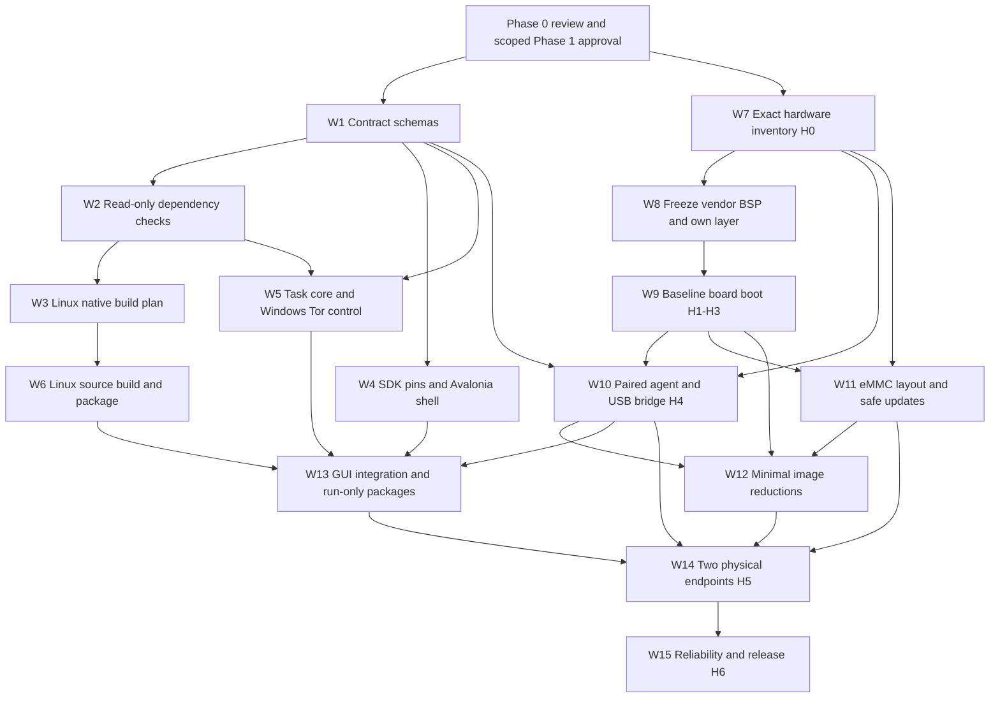

# 04 — Task DAG, milestones and Codex execution

Status: ASSUMPTION — future execution plan. Phase 0 only authored documentation
and ran the checks in [00](00-repository-audit.md). No implementation branch,
worktree, CI job, background runner or sub-agent was created/dispatched.
Repository anchors: `AGENTS.md`, `docs/ROADMAP.md`, `scripts/{check.py,check_buildroot.py,validate.py,common.py}`,
`.github/workflows/validate.yml`, `config/policy.json`.

## Dependency DAG

Every W package is a separately reviewable PR boundary. Larger packages must
be split along the described sub-boundaries before execution; no PR is allowed
to bundle an unreviewed board port, new agent, GUI and optimizer. Dependencies
are semantic gates; a merge does not imply runtime acceptance. Reviewed TASK 01
integration order is strictly W1 → W2 → W3. Independent preparation/tests can
run in parallel, but W1 exclusively owns shared contracts.

## Prioritized mergeable work packages

| ID / priority / owner role | Depends on / scope | Precise acceptance and regression gate |
| --- | --- | --- |
| W1 / P0 / contracts maintainer | Phase 1 scope approval. Add versioned JSON schemas for the eight contracts from [01](01-system-architecture.md), synthetic valid/invalid fixtures and stdlib validation entry point. No GUI/runtime change. | Validate null/unavailable measurements, status vs comparison, required fields, digest shape, progress bounds, target/profile constraints and incompatible schema rejection. Keep existing legacy JSON unchanged; portable `scripts/check.py` remains green except documented platform skips. |
| W2 / P0 / dependency maintainer | W1. Read-only CLI for OS/arch, native Python/tool probes, resource snapshot and Windows UCRT64 availability; emit DependencyCheck + reviewable remediation metadata. No installer or package-manager mutation. | Wrong compiler target, absent tool, inaccessible version probe, missing Linux host and unknown board map to incompatible/missing/unknown correctly. No `COMPILE.cmd`, sudo, pacman install or download executed. Tests exercise safe argv/path handling and blocked probes with injected observations; logs redact secrets. |
| W3 / P0 / Linux adapter maintainer | W1, W2. Add `scripts/native_linux/` **plan/preflight only**: consume existing source pins, produce typed BuildRequest/build DAG for one Linux x86_64 target and private-prefix output paths. No compilation required in this PR. | Plan references actual archive/license hashes and a separate Linux ABI/toolchain inventory; refuses Windows/WSL-mounted spaced output, unknown compiler and conflicting output scope. Tests prove no source fetch/build/install side effects in plan mode and reject unsafe input paths. No measured build success claimed. |
| W4 / P1 / desktop maintainer | W1. First PR chooses compatible .NET SDK/TFM/Avalonia pins, locks packages and adds Windows/Linux Avalonia shell with simulated data; subsequent PR adds dashboard/log/progress views. | Restore/build on declared environments only after opt-in tool setup. UI responds during fake task stream, distinguishes indeterminate progress/BLOCKED/SKIPPED and does not run process commands. Report exact supported distro/Windows scope. No board .NET dependency. |
| W5 / P1 / orchestration maintainer | W1, W2. Split task state/cancel/retry/log core from Windows local Tor-control/process adapter. Reuse verified Windows package; wrapper never modifies Tor source/flags. | Behavior tests for interrupted/retried task, bounded log stream, raw exit preservation, SAFECOOKIE event/reply interleaving, invalid authentication and restricted listeners. Offline native startup/shutdown in new private test state; unchanged online suite only at relevant approved gate. Cancel cannot orphan a managed Tor process or expose cookie. |
| W6 / P1 / Linux build maintainer | W3. Separate PRs for verified source preparation/build and ELF packaging; no optimization changes mixed with initial port. | Native Linux clean build and manifest, actual flags/config, source/license hashes and runtime closure; Linux hardening checks and native offline runtime tests. Execute frozen nine online assertions at integration gate on chosen host; standalone host qualification cannot use QEMU evidence. |
| W7 / P0 hardware / hardware custodian | Phase review; independent of W1–W6. Record full SoM/carrier/revision, electrical facts, storage and recovery route. Can merge inventory separately. | H0 evidence in [03](03-hardware-yocto-plan.md). Use PICO-IMX6UL as primary v1; retain DHCOM only as historical candidate. Unknown fields explicitly BLOCKED. No purchasing/flashing inferred from documentation approval. |
| W8 / P1 / BSP maintainer | W7 for final board selection. Source audit can proceed independently; final freeze waits for carrier mapping. Split immutable BSP/provenance lock PR from skeleton layer PR. | Verify machine/BASEBOARD/DTB/U-Boot mapping, versions/host compatibility, all layer commits/licenses, Tor recipe conflicts; exactly two image recipes baseline/minimal. Linux parse/layer checks when cached inputs/host available; no unsupported compatibility override. No boot claims. |
| W9 / P1 / bring-up engineer | W8, H0 and explicit hardware-test authorization. Build only baseline on recoverable media; split build/provenance from physical bring-up evidence. | H1 UART/kernel/DTB boot, H2 Ethernet/time/entropy, H3 public bootstrap and authenticated production controls. Capture exact image/config/serial. Baseline is partial product integration until agent/storage gates pass. Existing Buildroot inputs/reference and nine assertions unchanged. |
| W10 / P1 / device maintainer | W1, W7, W9 for hardware deployment. Authentication/protocol tests can proceed after W1; USB proof waits for H4. Split agent pairing/status from bounded SOCKS/application bridge. | Unpaired/revoked client rejected; no shell/key export or public management bind; cookie stays loopback. H4 simultaneous Ethernet + USB, Windows/Linux compatibility, replug/suspend, subnet isolation, no DNS/default route override; stream integrity/backpressure/half-close/cancel within measured resource bounds. |
| W11 / P1 / storage maintainer | W7, W9. First PR layout/threat model and recovery procedure; later updater/boot integration behind explicit deployment approval. | Exact board/partition match; signed/hash-verified inactive-slot write; rejection of wrong board/hash/signature/rollback-incompatible state; interrupted update/boot metadata recovery evidence. Tor identity retained; no automatic state erase. No final power-loss qualification before H6. |
| W12 / P2 / image maintainer | W9–W11. One measured removal/config reduction per PR, common baseline/minimal security/runtime. | Same-board baseline and minimal with identical toolchain/workload/state and explicit reference; nine functions, hardening, daemon, state/headroom, resources and policy. Size target aspirational. Keep rejection if any required assertion/metric is missing or threshold fails. |
| W13 / P2 / desktop integration maintainer | W4–W6, W10. Split read-only device/dashboard integration, build manager, then package release PRs. | Portable self-contained win-x64/linux-x64 packages launch on supported clean hosts without SDK. Developer/Embedded opt-in wizard displays exact install actions/privileges/reboot. Downloads/install/build/deploy/bootstrap/test stages report real or indeterminate progress. Flash/install requires separate scoped confirmation; no identity in package. |
| W14 / P2 / validation maintainer | W10–W13; two actual boards/PCs and approved public gate. Independent test PR extends coverage without altering frozen suite. | H5 unchanged nine assertions on both endpoints with USB↔Ethernet split, both directions and SHA-256 payloads, same-identity reconnection and persistence; manifests label physical hardware. No skipped mandatory checks, unknown metrics or mismatched reference accepted. |
| W15 / P2 / release owner | W14. Separate endurance/power-cut procedure from final measured release decision. | H6 repeated cold boots, sustained traffic, thermal/RAM/CPU/I/O/state growth and update/power-loss recovery with bounded logs; all required data and retained failures. Review resource budgets, licenses/signatures and rollback before release. No bare-metal/RTOS implementation in v1. |

The first three implementation PRs are deliberately small: **W1 contracts,
W2 read-only dependency CLI, W3 Linux plan/preflight adapter**. W3 is not a
claim that native Linux compilation already exists. GUI scaffolding and source
BSP inspection can proceed later in parallel after contract/version ownership
is agreed. Hardware is not a prerequisite for contract/preflight work. Neither are Yocto
build RAM reservations. TASK 01 selects Ubuntu 24.04 x86_64-linux-gnu/glibc 2.39
for native Linux v1, with additional ABIs explicitly deferred.

## Regression and validation tiers

| Tier | When / command | What it can establish |
| --- | --- | --- |
| Q0 | Each relevant change: `python3 scripts/check.py` (native Windows uses `python`) plus affected new unit checks; `python -m unittest discover -s windows-native/tests -v` for Windows source/packaging changes | Portable logic, fixtures and locks only. Document exact skips; no public Tor, board or performance claim. |
| Q1 | Buildroot config changes on native Linux, with already verified source cache: `python3 scripts/check_buildroot.py` | Real Kconfig resolution without target build. Confirm cache first because script can download/extract sources; no silent expensive fetch. Not applicable to six-doc Phase 0 on Windows. |
| Q2 | Adapter/package changes: matching host offline startup/hardening/control tests; Yocto metadata checks on selected Linux host | Functional integration limited to executed host/profile. Offline `tests/run_all.py` intentionally skips six online assertions and returns nonzero; record partial evidence accurately. |
| Q3 | Explicit complete-image gate: `./scripts/validate.sh --profile <existing-profile> --mode online` or unchanged native `tests/run_all.py --mode online --tor <verified-binary>` in new private state | Build + full public suite when executed. `validate.sh --mode offline` can still build and never fully qualifies. No `--record-baseline` on an existing immutable baseline. |
| Q4 | H1–H6 on actual boards with exact storage/USB layout, repeated matched workload and full metrics | Physical qualification only for recorded board/firmware/layout; not inferred from QEMU or another carrier. |

Keep `config/policy.json` tests/thresholds and legacy fixture bytes/timeouts
frozen. A report must distinguish executed PASS/FAIL, SKIPPED, BLOCKED and
NOT RUN. Leave missing metrics null, record policy/protocol/reference hashes,
preserve failed runs, and separate test success from REJECTED/NON_COMPARABLE
comparison. Use Windows working-set and Linux RSS/PSS method labels correctly.
Do not repeat broad tests after documentation-only edits; do structural review.

## Worktree and ownership plan

Future worktrees require native Linux no-space paths for Linux/Yocto and
no-space Windows build outputs. Inspect HEAD/status/stashes before creation;
never use reset/clean or overwrite existing trees/caches. Proposed branches:

| Lane / branch | Exclusive file ownership | Waits / sharing rules |
| --- | --- | --- |
| Contracts/core: `codex/contracts-core` | `config/contracts/`, `desktop/Tor.Contracts/`, `desktop/Tor.Core/` | One contract owner; publish schema revision before consumers merge. |
| GUI: `codex/desktop-gui` | `desktop/Tor.Desktop/`, GUI tests | No edits to contracts or locks owned by another lane; request interface changes via owner. |
| Native Linux: `codex/native-linux` | `scripts/native_linux/`, Linux adapter/tests | Consume frozen locks; source-lock change is a separate coordinated PR. |
| Dependencies: `codex/dependency-tooling` | `config/dependencies/`, `scripts/dependencies/` and corresponding tests | Read-only detection; no download/install/COMPILE.cmd; install executor outside TASK 01. |
| Yocto: `codex/yocto-plan` | `yocto/meta-tor-minimal/`, future BSP lock, board evidence | Hardware/DTB dependencies block final board claims, not independent source research. |
| Validation: `codex/validation` | New validation adapters/evidence directories | Existing frozen tests and policy only reviewed as read-only dependencies. No agent rewrites another lane's evidence. |

No two agents edit the same files. Shared architecture docs, root CI files,
source locks and `docs/PROGRESS.md` have a designated integrator. Land minimal
contract PR first, then rebase consumers without discarding user edits. Record
provenance of cherry-picks/merges; no concurrent writes to common output dirs.
Delegation is a future execution option only when explicitly authorized; none
was used in Phase 0.

## Cache, process and machine limits

Current measured host snapshot is in [00](00-repository-audit.md): 16 logical
CPUs, 33,377,124,352 B total RAM, 16,555,892,736 B available and
560,488,251,392 B free on C:. WSL ext4 capacity, memory/swap caps and Linux
compiler inventory are UNVERIFIED; Windows free space is not a WSL resource
reservation. No GPU/CPU speed or build-time measurement was fabricated.

ASSUMPTION scheduling policy for implementation review:

- Allow at most **one heavy compiler/image job per physical host** until peak
  RAM/disk measurements justify a different cap. GUI/unit work is permitted
  concurrently only inside measured spare resources. CPU thread count alone
  never authorizes `-j16` or parallel Buildroot/Yocto/Windows builds.
- For a Buildroot job start from repo's 6 GiB RAM / 40 GiB disk reservation,
  retain an additional proposed 4 GiB available OS headroom, and probe actual
  Linux limits. These are initial host budgets, not measured peak needs.
- For initial Yocto planning reserve a conservative **32 GiB RAM / 250 GB free
  workspace** plus proposed 4 GiB OS headroom and failure/cache space; this is
  a scheduling ASSUMPTION, not a universal Yocto requirement. The current
  snapshot does not satisfy that RAM reservation. Use a qualified dedicated
  Linux runner or revise from measured single-build data with explicit review.
  See [vendor host guidance](https://github.com/TechNexion/tn-imx-yocto-manifest)
  and [Yocto 6.0 guidance](https://docs.yoctoproject.org/6.0/brief-yoctoprojectqs/index.html).
- Windows build peak memory/disk UNVERIFIED; begin one build with explicit
  low JOBS after user-approved measurement plan. Existing nproc default must
  not override orchestrator reservation. Pause scheduling at disk low-water
  mark; never delete baseline/failed logs/large outputs to force admission.

Cache key must include source archives/patches + resolved config + target
ABI/architecture + compiler/linker/OS package inventory + BSP/layer revisions +
build adapter version. Downloads may be shared read-only after hash checking;
mutable build trees may not. Publish completed cache entry atomically and lock
writers. Separate outputs for incompatible inputs/toolchains; do not use
`make clean` to repurpose a preserved tree. Existing Linux input hash covers
`config/br2-external/scripts/tests`; existing Windows hash also records compiler
and package inventory. Future adapters add missing host/toolchain dimensions
without claiming old cache semantics were broader than the code implements.

For long builds/tests, **future** execution uses an explicitly dispatched CI job
or independent runner with run ID, immutable inputs, allocated resources,
bounded job lifetime, cancellation and retained stdout/stderr/artifact digests.
The current repository already supports manually dispatched Linux full builds
in `.github/workflows/validate.yml`; it has no implemented GUI/Yocto runner.
Do not claim an unavailable runner or a process survives an app/session exit.
Where terminal sessions actually provide asynchronous polling, record session
ID and collect completion/exit code; otherwise use a real CI/runner before
starting long work. Keep short status updates responsive and continue only
independent documentation/unit work while waiting. Never start a dependent
flash/test before its build/hash evidence arrives.
