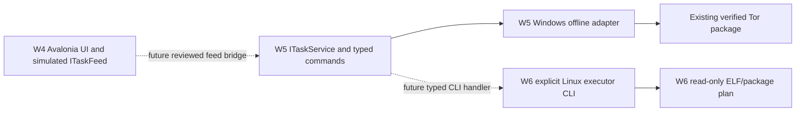

# TASK 04 — W4/W5/W6 integration overview

Date: 2026-11-17. Starting remote main:
`1120723c806a01f9a923f5c4e489bc8a7ae23798`.
These are separate draft PRs for review. None has been merged. No W7–W15
implementation, Tor source compilation, firmware, public Tor test or device
operation was performed.

## Review boundaries and dependency graph

| PR | Branch | Base | Implementation/evidence commit |
|---|---|---|---|
| [#7 W4 desktop](https://github.com/JozefKovalcin/Tor-Client-for-embedded-systems/pull/7) | `codex/task04-w4-desktop` | main | `8b1fa1b13154b7602d8d9000c05d5b12436371ac` plus this integration record |
| [#5 W5 core](https://github.com/JozefKovalcin/Tor-Client-for-embedded-systems/pull/5) | `codex/task04-w5-task-core` | main | `19670692c0b9a29c1e5082f4a442a34fc8237fb5` |
| [#10 W5 Windows](https://github.com/JozefKovalcin/Tor-Client-for-embedded-systems/pull/10) | `codex/task04-w5-windows-control` | W5 core | `6712ae69a070167b4b9d1182ed570288ad1e4585` |
| [#8 W2 correction](https://github.com/JozefKovalcin/Tor-Client-for-embedded-systems/pull/8) | `codex/task04-w2-gcc-banner` | main | `fcd8df8c0bd4988d922276c9ac0e06d9d88c834d` |
| [#6 W6 executor](https://github.com/JozefKovalcin/Tor-Client-for-embedded-systems/pull/6) | `codex/task04-w6-linux-executor` | W2 correction | `9b8ba4f314a8997a6ddc38a6340f5e6406db5be6` |
| [#9 W6 package plan](https://github.com/JozefKovalcin/Tor-Client-for-embedded-systems/pull/9) | `codex/task04-w6-linux-packaging` | W6 executor | `3765c30b2092095d378c7592c272bf635b600341` |

Review core before Windows, and W2 correction before executor before package
plan. W4 is independent. These dependencies are not permission to merge.
Original commits were retained through ordinary merges; no force push,
destructive reset, squash, rebase or worktree/stash deletion was used.

W2 required its own small correction after an actual supported-host probe
found `x86_64-linux-gnu-gcc-13` UNKNOWN. Only numeric executable suffix
recognition changed; family, minima, target, trusted roots and subprocess
allowlists remain enforced. W3/W6 never replace a W2 decision with availability.

## Shared interfaces and ownership

The eight unchanged W1 v1 JSON schemas remain authoritative. W5 owns the C#
TaskProgress binding and `ITaskService`/`ITaskHandler`; W4 owns the internal
`ITaskFeed` presentation seam and UI; W6 owns the Python Linux execution and
inventory adapters. Shared source locks and existing policy were not rewritten.

Only the core-to-Windows adapter path is implemented and tested. The UI still
shows explicitly simulated data. Linux commands are not wired into the core.
No device/Yocto adapter exists.

The next integration needs a separately reviewed feed bridge: subscribe to
core progress, reconcile gaps with `Snapshot()`, reject stale sequence values,
dispatch updates on the UI thread and retain interrupted/error distinctions.
Register the typed Windows handler explicitly with the verified package and a
separate owner-only private parent. A future Linux handler must consume W1
requests/events, verified manifest refs and original exits/signals, and require
the exact fresh approved execution digest. UI components must not launch shells.

## Implemented behavior and dependencies

W4 provides eight navigable views, Run Only/Developer/Embedded explanations,
all task/dependency states, determinate/indeterminate progress, bounded logs,
local settings and Dark/Light palettes. SDK 11.0.100/net11.0/runtime11.0.0
uses the user's installed stable STS SDK. Run .NET commands from `desktop/`
to apply `global.json`; it is not an LTS claim. Three exact Avalonia 12.1.6
direct dependencies resolve to 25 packages in the genuine lock/inventory.
The user explicitly approved that one scoped NuGet restore. Subsequent build
validation used only its local cache. SDK-independent distribution is not built.

W5 core is BCL-only .NET11: typed commands, DAG/state/resource admission,
durable progress, bounded structured logs/events, deadlines, cancellation,
retry, crash recovery, original exits and verified file refs. Windows control
adds SAFECOOKIE-only loopback authentication, bounded multiline/event parsing,
bootstrap observations and managed lifecycle. It accepts only the recorded
static Windows Tor package and its DLL, stages only their verified bytes into
a fresh private directory, rehashes/locks them and excludes source-package
neighbors from execution. Networking is fixed disabled and SOCKS is disabled
for this foundation. Each retained session adds about 8.7 MB of staged runtime;
private state retention needs a future explicit policy, not automatic deletion.

W6 requires Python >=3.12 and selected Ubuntu24.04/x86_64/glibc2.39, compatible
GNU tools and the existing five pinned Tor/OpenSSL/libevent/zlib/libseccomp
archives/licenses. It adds fresh W3 qualification, exact-input approval,
verified snapshots, bounded no-link extraction, fixed hardened Linux recipes,
private prefix, process-group cancellation and build evidence. Package planning
reads bounded ELF metadata without executing ELF/ldd; it proposes only Tor and
five licenses. `packageArtifact` is null and `readyForDistribution` is false.
Signature trust remains the existing recorded SHA-256 boundary.

## Executed evidence

| Check | Actual result |
|---|---|
| Combined Windows portable suite | 156 discovered / 149 PASS / 7 platform SKIPPED |
| Combined native `/tmp` WSL test snapshot | 156 discovered / 151 PASS / 5 SKIPPED |
| Desktop app, combined checkout | Build PASS, zero warnings/errors; actual Windows launch/dashboard/build-placeholder navigation PASS |
| Desktop presentation/services harness | 40 behavior assertions PASS; five W1/pin/lock/UI-boundary guards PASS |
| Desktop visual checks | Actual Dark/Light, dependencies, mode selection, settings, failed/raw17/blocked/interrupted details PASS |
| Core harness | 15 compiled behavior groups PASS |
| Tor control harness | 9 compiled loopback protocol groups PASS |
| Existing Windows pipeline | 6 PASS |
| Actual existing Windows Tor, explicit offline smoke | Unauthenticated514, SAFECOOKIE/bootstrap0, stop/raw0, unexpected exit, cancellation, owner crash/no orphan, hash rejection and unlisted-DLL exclusion PASS |
| Whitespace and scope | `git diff --check` PASS |

The combined Linux snapshot has no Linux .NET11 SDK, so two compiled gates are
explicitly BLOCKED/SKIPPED there, alongside three Windows-specific tests.
Applicable core/control compilation also runs in their Linux GitHub CI jobs
when the SDK is present. Windows-only native Tor smoke is an explicit local
test, not an automatic portable/CI test. Seven Windows portable skips concern
the Linux shell/symlink and POSIX process/lock/preflight/inventory cases; those
were exercised on Linux. No skipped public test is treated as full qualification.

Actual native CI run [44106907712](https://github.com/JozefKovalcin/Tor-Client-for-embedded-systems/actions/runs/44106907712)
observed Ubuntu24.04/glibc2.39, four CPUs, GCC13.3, GNU Make4.3 and all required
tools AVAILABLE after the separate W2 fix. Exact resources/versions and the
earlier UNKNOWN observation are retained in the two native CI reports in
`reports/task04/`; incompatible local Ubuntu26.04/glibc2.43 WSL evidence is
also preserved. The probe deliberately used an empty unit-test archive cache.
MISSING means that cache only, not global source discovery. No BuildRequest
was emitted and no source was downloaded or built.

Existing GitHub lightweight workflows were used unchanged; their runner
provisioning and Kconfig resolution are separate from local validation.
The manual full-build job remains SKIPPED. No new full workflow was dispatched.

## Findings fixed during implementation

- W4 Light palette contrast corrected and visually rechecked.
- Core preserves unexpected exit0 as a failure classification with raw0.
- Unsupported-command and log-write rejection leave no admitted/executable
  task or subscriber event; old tasks/logs survive failed admission.
- Cancellation and teardown survive journal I/O failure; W1 `reasonCode`
  rejects unsafe refs. Four independent before/after reproductions passed.
- Linux runner claims logs before spawning and cleans up on failures; archive
  snapshots and ELF DT_TEXTREL/DF_TEXTREL regressions fail safely.
- Windows SAFECOOKIE rejects unauthorized/unverified peers and ignores
  pre-authentication events; only verified runtime files enter its launch path.

Initial failed checks and logs were retained: Windows sandbox/temp restrictions,
an approval-service usage-limit error (action not executed; normally approved
retry later succeeded), initial core regressions, and DrvFS nanosecond rounding
in the unchanged W3 test. The native `/tmp` rerun passed without weakening it.
Logs/private test state remain in ignored per-worktree build folders.

## Limits and next review

Linux GUI launch, clean-host/self-contained runtime distribution, real GUI
monitoring, online Windows operation, real Linux source build, ELF symbol/ABI
closure, package execution and native runtime/public qualification remain
NOT RUN or BLOCKED. Source compilation, new dependency/source downloads and
installations still require separate scoped authorization. Do not infer these
from successful synthetic tasks, an ELF metadata pass or supported host facts.

Application reservations are not kernel/global-host quotas. Hash-verified
upstream build scripts are trusted code rather than a sandbox. Exact PICO
SKU/carrier/DTB remain BLOCKED; PICO is primary and DHCOM historical only.
Existing source locks, Windows patch, Buildroot configuration, frozen tests,
thresholds, historical reports, baseline and stashes remain preserved.

Review the draft PRs and remaining gates before authorizing further local
integration. Do not start W7–W15, device deployment, public tests or real source
compilation from this handoff.
